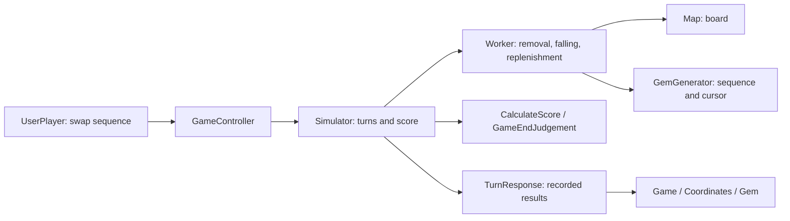
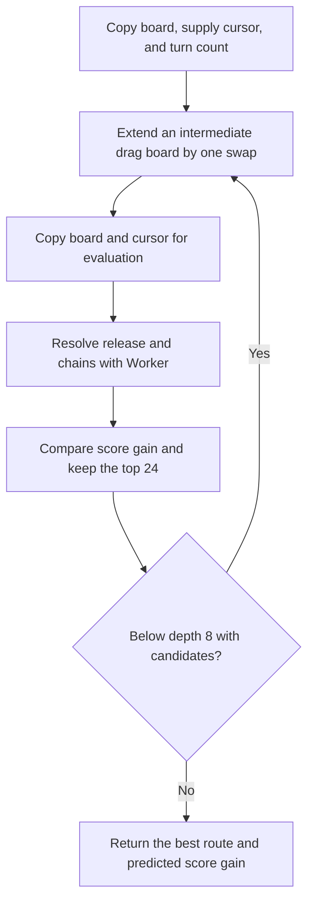

# Pg

[English](README.en.md) | [日本語](README.ja.md)

A Unity puzzle game on a hexagonal board. Drag a gem through adjacent gems to make a sequence of swaps, then release to resolve matches, falling gems, replenishment, and chains. Connected groups of at least four matching gems disappear. Reach the target score within the turn limit.

[Gameplay video](Documents/play.mov)

## Getting started

1. Open the project with Unity **6000.6.7f1**, as recorded in [ProjectSettings/ProjectVersion.txt](ProjectSettings/ProjectVersion.txt).
2. Install the dependencies below and let Unity Package Manager resolve packages and compile scripts.
3. Open `Assets/Scenes/TitleScene.unity`, enter Play mode, and start the game. You can also start from `GameScene.unity` to inspect gameplay directly.
4. Press a gem, drag through adjacent gems to swap, and release to submit the turn. Releasing without swapping does not consume a turn.
5. Press `Hint` to see a suggested route and its predicted score gain. Follow the numbered cells from 0. Revisiting a cell displays multiple numbers. Selecting a gem clears the hint.

Scenes follow `TitleScene → GameScene → ResultScene → TitleScene`. All three are registered in [EditorBuildSettings.asset](ProjectSettings/EditorBuildSettings.asset).

### Dependencies

| Library | Purpose and setup |
| --- | --- |
| DOTween | Movement, disappearance, appearance, and screen effects. Install separately, then run Setup DOTween from Tools → Demigiant → DOTween Utility Panel. The project references `DOTween.Modules`. |
| UniRx | Input events and turn submission. Install separately with its assembly definition. |
| UniTask | Awaiting animation and scene flow. `Packages/manifest.json` specifies version 2.5.11. |
| Unity Input System / uGUI | Input and UI; included in the Package Manager dependencies. |
| Unity Test Framework | EditMode tests; included in the Package Manager dependencies. |

`UNITASK_DOTWEEN_SUPPORT` must be present in Scripting Define Symbols to await DOTween animations with `.ToUniTask()`. It is already enabled in the current settings. Check it again when changing the build target.

See [Packages/manifest.json](Packages/manifest.json) and `Packages/packages-lock.json` for exact package specifications. `Library`, generated `.csproj` / `.sln` files, and some external libraries are excluded from Git.

## Rules and data

| Term | Meaning |
| --- | --- |
| Tile | A fixed hexagonal cell: occupied (`Contain`), empty (`Empty`), or closed (`Closed`). |
| Gem | A piece with one of seven colors: Green, Red, Purple, Blue, Yellow, Orange, or Rainbow. |
| Cluster | A connected group of matching gems using six-way adjacency. A straight line is not required. |
| Vanish | Removal of clusters containing at least four gems. Rainbow can connect to other colors during each color's search. |
| Slide | Falling into empty cells and replenishment from the top. |
| Turn | A sequence of drag swaps and resolution of all resulting chains. |
| Chain | An additional disappearance step after falling or replenishment within the same turn. |
| Stage | The initial board, maximum turn count, and target score. |

The current board is **7 columns × 6 rows** (`TileSize`), and the minimum cluster size is **4** (`Setting.MinClusterSize`). Arrays use `TileStatus[column, row]`, with row 0 at the top.

### Scoring and game end

`CalculateScore` computes the following value for each cluster. Step and turn scores accumulate into the total.

```text
cluster score = (int)(0.1f × (t + 1) × (10 × n + 10 × n × c))
n: number of gems in the cluster
c: disappearance step within the turn, starting at 0
t: completed turns before the current turn, starting at 0
```

The floating-point result is converted to an integer separately for each cluster. On the first turn, a cluster of four earns 4 points; another cluster of four in the next chain step earns 8. If a Rainbow gem belongs to multiple color clusters, scoring processes each cluster, while presentation and vanished-gem statistics deduplicate coordinates.

`Simulator` increments the turn count before calling `GameEndJudgement`. Reaching the target score produces success; otherwise reaching the turn limit produces failure; otherwise play continues. Success takes precedence when the target is reached on the final turn.

## Design

### Simulation and presentation boundary

The central design is to **calculate a turn first, then play its recorded results on screen**. Game outcomes do not depend on animation duration or GameObject positions.

`GameController` receives initial data and a replenishment sequence. Given a sequence of `GemOperation` values, it updates the board, score, and turn count and returns a `TurnResponse`. The scene replays the recorded removals, movements, and creations. This boundary allows simulation tests without rendering and lets hint search reuse the same resolution logic.

The simulation assemblies still use Unity assertions, and `Pg.Rule.JudgeResult` references UniTask. Presentation logic is separated, but the simulation is not a completely Unity-independent library.



### Assemblies and responsibilities

Source lives under `Assets/Scripts/Pg`. Assembly definitions (`.asmdef`) separate module references, and implementations generally use `internal` visibility. The table lists the main project dependencies; external library references are omitted.

| Assembly / location | Responsibility | Main references |
| --- | --- | --- |
| `Pg.Etc` / `Etc` | Board dimensions, match threshold, and enumeration helpers | — |
| `Pg.Data` / `Data` | Input interfaces, coordinates, cell states, and score values | `Pg.Etc` |
| `Pg.Rule` / `Rule` | Scoring and continuation/success/failure judgement | `Pg.Data`, `Pg.Etc` |
| `Pg.Puzzle` / `Puzzle` | Public API, simulation, hint search, and responses | `Pg.Data`, `Pg.Rule`, `Pg.Etc` |
| `Pg.SceneData` / `SceneData` | Result data passed between scenes | — |
| `Pg.App` / `App` | Scene transitions and Unity helpers | `Pg.SceneData`, `Pg.Etc` |
| `Pg.Scene.Game` / `Scene/Game` | Input, stage assets, board presentation, effects, and statistics | `Pg.Puzzle`, `Pg.Data`, `Pg.Rule`, `Pg.App`, `Pg.SceneData`, `Pg.Etc` |
| `Pg.Scene.Title`, `Pg.Scene.Result` | Title and result screens | `Pg.App` and related modules |
| `Pg.Editor` / `Editor` | Inspector editing helpers | Data, puzzle, and gameplay modules |
| `Pg.Puzzle.Tests` / `Puzzle/Tests` | EditMode tests | `Pg.Puzzle`, `Pg.Data`, `Pg.Rule`, `Pg.Etc` |

`Internal` holds board-processing implementations, `Request` holds operations, and `Response` holds calculated results. The scene's `Public` directory contains stage types accessible from other modules. `InternalsVisibleTo` in `AssemblyInfo.cs` lets tests inspect internal implementations.

### State ownership

| Type | State / responsibility |
| --- | --- |
| [`GameController`](Assets/Scripts/Pg/Puzzle/GameController.cs) | Entry point used by the scene; delegates to `Simulator`. |
| [`Simulator`](Assets/Scripts/Pg/Puzzle/Internal/Simulator.cs) | Coordinates `Map`, `Worker`, `GemGenerator`, `Turn`, `ScoreBoard`, and `GameEndJudgement`. |
| [`Map`](Assets/Scripts/Pg/Puzzle/Internal/Map.cs) | Current `TileStatus[,]`; provides swaps, removal, gem insertion, and board copies. |
| [`GemGenerator`](Assets/Scripts/Pg/Puzzle/Internal/GemGenerator.cs) | A copied replenishment sequence and its next-read cursor, preserved across turns. |
| `Turn` / `ScoreBoard` | Completed turn count / accumulated score. |
| [`Worker`](Assets/Scripts/Pg/Puzzle/Internal/Worker.cs) | Applies operations, detects clusters, removes gems, and processes falling. Obtains replenishments from `GemGenerator`. |
| [`Coordinates`](Assets/Scripts/Pg/Scene/Game/Coordinates.cs) | Fixed `Tile[,]` and a coordinate-keyed dictionary of visible `Gem` objects. |
| [`UserPlayer.Sequence`](Assets/Scripts/Pg/Scene/Game/UserPlayer.cs) | The originally grabbed gem and swap history for the active drag. |
| [`Game.Record`](Assets/Scripts/Pg/Scene/Game/Game.cs) | Turn count, additional chain count, vanished-gem count, and final score for the result screen. |

`Map` copies the initial array. `TileStatus` and `Coordinate` are value types; colors use `GemColorType` enumeration objects. Arrays returned by `DebugGetTileStatuses()` and `StartGame()` reference the current internal board and must be treated as read-only by callers. Hint snapshots are copied separately.

### Initialization and stage settings

`Scene/Game/Public/GameData` is a `ScriptableObject` implementing `IGameData`. It holds six rows of cell settings, a turn limit, and a target score, and converts them into a `Stage` implementing `IStage`. Create an asset through the `Pg/GameData` Create menu.

After the starting animation, `Game.Start()` randomly generates a replenishment sequence from the seven colors and constructs `GameController`. `Coordinates.Initialize()` creates tiles and gems, then score presentation and input become active. Randomness belongs to the scene's sequence generation; `GemGenerator.Next()` does not generate random values.

### From input to a completed turn

1. A pointer-down event on `Gem` starts a `UserPlayer.Sequence`.
2. Entering another adjacent gem swaps it with the originally grabbed gem. That gem's coordinate moves, allowing the route to continue. The visible objects and `Coordinates` dictionary update, and a `GemOperation(A, B)` is appended to history.
3. Pointer-up publishes `GemOperation[]` through UniRx's `OnTransaction`. An empty history is ignored; a nonempty submission disables input.
4. `Game` calls `GameController.ProcessTurn()`. The simulation board has not changed during the drag, so it now applies the entire swap sequence in order.
5. `Worker` resolves removal, falling, replenishment, and chains. `Simulator` scores each step, updates the total and turn count, and judges the result.
6. `Game` plays the calculated results in order. Continuing re-enables input; success or failure plays an ending effect, waits for a tap, and opens the result screen.

Matches resolve after the drag is submitted, not during intermediate swaps. Player drags have no eight-swap restriction; eight is only the hint search limit.

`GameRule.CanSwap()` checks hexagonal adjacency. `ProcessTurn()` applies the supplied operations directly rather than comprehensively validating legal input. Callers outside the scene must manage valid coordinates, swap targets, and turn state.

### Hex coordinates and cluster detection

`DirectionService` computes six neighboring coordinates according to column parity. `CoordinateService` checks bounds and identifies the top row. Presentation uses the same parity-based offsets in `Coordinates.CreateTiles()`.

`Worker.DetectClusters()` scans the board for each color and recursively visits connected matching cells. Visited-coordinate tracking prevents repeated traversal, and Rainbow cells can join that color's connected component. Groups meeting `MinClusterSize` are recorded in `VanishingClusters`. All detected clusters are emptied before falling and replenishment begin.

### Falling, replenishment, and chains

`Worker.ProcessStep()` copies the starting board, detects and removes clusters, and processes falling and replenishment. Steps with disappearing clusters are returned as `SimulationStepData`; resolution stops when no cluster disappears.

Falling scans rows from bottom to top and columns from right to left. Empty top-row cells receive new gems. For other empty cells, the worker checks the cell directly above and, when its conditions permit, tries the above, upper-left, and upper-right candidates in order, moving the first available gem. Moving a gem out of the top row immediately replenishes that source cell. Scans repeat until no movement occurs; the internal falling loop throws after its 1000-iteration safety limit.

Scan order affects destinations and replenishment consumption. Changing that order can change chain outcomes even with the same supply sequence.

### Replenishment and reproducibility

`GameController.CalculateRequiredGemCount(stage)` returns **all array cells × maximum turns**, including closed cells. Multiplication uses `checked` overflow detection. This is a minimum buffer size, not an upper bound on all gems consumed by chains.

`GemGenerator` asserts that the input meets the required length and copies it into an array. It consumes the sequence continuously across turns, wrapping to the beginning at the end. It neither regenerates the sequence nor resets the cursor each turn.

With the same implementation, initial board, stage settings, operations, and replenishment sequence, simulation results are reproducible. Normal gameplay creates a fresh sequence with `System.Random`, so the operations alone are insufficient for replay. Reproduction tests also need the actual supply sequence. No save or replay file format is currently provided.

### Responses and animation

| Response | Contents |
| --- | --- |
| `TurnResponse` | Step sequence, updated total score, and game-end judgement. |
| `SimulationStepResponse` | Starting board, disappearing clusters, falling/generation history, and score gain. |
| `SlidingGems` | Existing-gem movements in `Items`, created gems in `NewGems`, and interleaved order in `EventTypes`. |

`SlidingGems` stores movement and creation payloads separately. `Take` / `NewGem` entries in `EventTypes` reconstruct their original order, and `Coordinates.ApplySlides()` consumes both sequences accordingly. Playing all movements before all creations can break correspondence with the simulation.

Each step follows: verify the starting board, animate removals, add score, then replay movements and creations. Removal coordinates are deduplicated and animated concurrently; movement and creation events are awaited in recorded order. At the end of the turn, `AssertMatches()` also compares coordinates, colors, and gem counts with the simulation board. These checks run when `UNITY_ASSERTIONS` is enabled.

`Tile` represents a fixed cell. `Gem` owns its cell reference, color, input, and Tweens. Initial and replenished gems use the same creation path; disappearing gems are destroyed after their animation finishes.

### Beam search hints

Hints seek a drag route with a high **score gain when the current turn is released**. They do not search future turns. However, the upcoming replenishment sequence is treated as known, allowing the entire current turn's chains to be simulated.

1. `GameController.FindHintAsync()` snapshots the board, supply cursor, and completed turn count.
2. `HintSearch.Find()` runs through `Task.Run`. Every occupied cell supplies an initial node representing a possible starting point.
3. Each node extends by one swap in up to six directions. Out-of-bounds cells, cells without gems, and immediate reversal of the previous swap are excluded.
4. Candidates at the same depth are deduplicated by swapped board contents and the grabbed gem's current coordinate.
5. Evaluation makes another copy of the board and supply cursor, then resolves removal, replenishment, and chains with the same `Worker` and `CalculateScore` used by actual play.
6. The 24 highest-scoring candidates continue to the next depth. Search reaches at most eight swaps and returns the best route found across all depths.



A search node retains the **intermediate drag board**. Extending the board after evaluation has resolved its chains would incorrectly allow removals during a drag. Separate copies therefore serve evaluation and route extension. Each evaluation also begins at the same supply cursor, so earlier candidates do not consume gems needed by later candidates.

| Setting | Current value | Meaning |
| --- | --- | --- |
| `beamWidth` | 24 | Candidates retained for the next depth; the initial starting cells are not limited by this width. |
| `maxSwaps` | 8 | Maximum swap count per searched route. |
| Evaluation chain limit | 128 steps | Candidates exceeding this are discarded to avoid endless chains with a repeating supply. |

The first best candidate is retained on ties. A zero-point route can be returned if all candidates score zero; no valid candidate produces `null`. Since beam search discards intermediate candidates, it does not guarantee an optimal route even within eight swaps.

Gameplay input is disabled during search and restored afterward. `HintResult` provides a read-only swap sequence and the predicted score gain for this turn. The scene draws lines and numbered cells using `OnGUI`. Search does not update the live board, total score, turn count, or supply cursor.

### Results between scenes

`Game.Record` converts gameplay statistics into `ResultData`. Chain count excludes the first disappearance step of each turn; vanished-gem count deduplicates coordinates within each step. `Pg.App.SceneManager` places the result in `TheSceneData` before loading `ResultScene`, which reads and displays it. `TheSceneData` is an in-memory handoff reset when execution starts, not persistent storage.

### Where to make changes and current constraints

| Change | Main locations and considerations |
| --- | --- |
| Match threshold | `Etc/Puzzle/Setting.cs`; live play and hints share `Worker`. |
| Scoring or win conditions | `Rule/CalculateScore.cs`, `Rule/GameEndJudgement.cs`; scoring changes also affect hint evaluation. |
| Board shape or dimensions | Coordinate changes across `TileSize`, the six-row `GameData` layout, `Map` / `Worker` loops, and `Coordinates` placement. Arbitrary sizes are not supported. |
| Falling rules | `Worker.SlideGems()` and `DirectionService`; also verify supply consumption and presentation history. |
| Hint search effort | Default arguments of `HintSearch.Find()`; greater width and depth increase evaluation time and memory use. |
| Presentation | `Coordinates`, `Gem`, and `Direction` under `Scene/Game`; preserve response semantics and event order. |

The 128-step chain limit only applies to hint evaluation. Live chain resolution has no equivalent overall limit; the 1000-iteration guard applies to falling scans within one step. Hint search currently has no cancellation or time-limit API.

The initial board must not contain empty cells (`Empty`). Each cell must be occupied (`Contain`) or closed (`Closed`). `Simulator` asserts this during initialization when `UNITY_ASSERTIONS` is enabled.

## Tests and development

Run `Pg.Puzzle.Tests` in Unity through **Window → General → Test Runner → EditMode**.

| Tests | Coverage |
| --- | --- |
| [`GemSupplyTests`](Assets/Scripts/Pg/Puzzle/Tests/GemSupplyTests.cs) | Required buffer length, multiplication overflow, copying, wraparound, length validation, and preserving the supply cursor across turns. |
| [`HintSearchTests`](Assets/Scripts/Pg/Puzzle/Tests/HintSearchTests.cs) | Cursor cloning, preserving live state, repeated-search reproducibility, adjacent route steps, predicted versus actual score, exhaustive single-swap comparison, and a fully closed board. |

For command-line execution, close any Unity Editor using the project and point `UNITY_EDITOR` to the editor executable you want to use.

```sh
UNITY_EDITOR="/path/to/Unity"
"$UNITY_EDITOR" -batchmode -nographics -projectPath "$PWD" \
  -runTests -testPlatform EditMode -assemblyNames Pg.Puzzle.Tests \
  -testResults /tmp/pg-editmode-results.xml -logFile /tmp/pg-editmode.log
```

Run this from the repository root. Tests focus on simulation. Also check input, hint rendering, Tweens, and scene transitions in Play mode.

`make test` serves a different purpose: simple checks for `#nullable enable` and visibility conventions in C# files. It does not run NUnit tests and requires tools including `fd` and Perl. `make documents` generates diagrams from `Documents/*.puml` using PlantUML.

The existing [module diagram](Documents/module.png) and [PlantUML source](Documents/module.puml) describe an earlier design. Use this README, assembly definitions, and implementation for current dependencies. `README.md` is a symbolic link to `README.en`.

## Reference

[Hexagonal Grids — Red Blob Games](https://www.redblobgames.com/grids/hexagons/)
