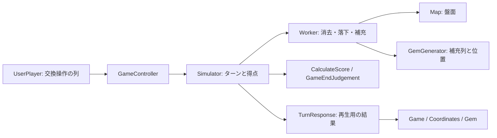
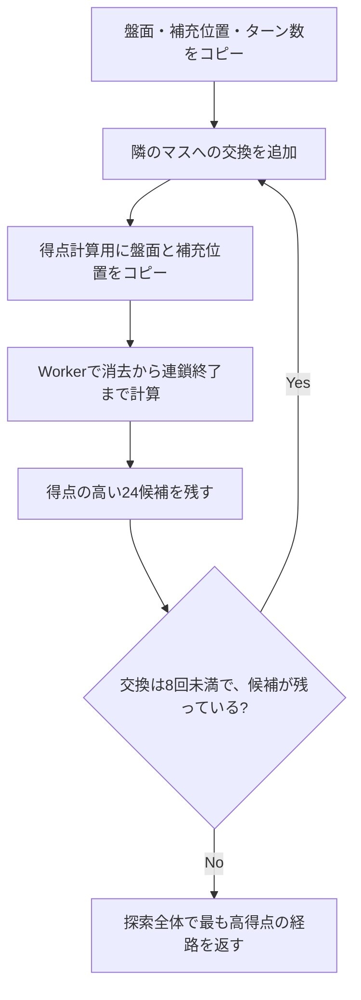

# Pg

[English](README.en.md) | [日本語](README.ja.md)

六角形のマスに並んだ宝石を動かし、同じ色を4個以上つなげて消すパズルゲームです。宝石をつかんだまま隣接する宝石をなぞると、その宝石と入れ替わります。ドラッグを終えたときに同色の宝石のまとまりがあればそれらの宝石が消え、空いたマスに宝石が落下・補充されます。そこで新たなまとまりができると連鎖が起こります。制限ターン以内に目標スコアを達成すればクリアです。

[プレイ動画](Documents/play.mov)

## 起動と操作

1. [ProjectSettings/ProjectVersion.txt](ProjectSettings/ProjectVersion.txt) に記録されたUnity **6000.6.7f1** でプロジェクトを開きます。
2. 下記のライブラリを導入します。Unity Package Managerによるパッケージの取得と、スクリプトのコンパイルが終わるまで待ちます。
3. `Assets/Scenes/TitleScene.unity` を開き、Playモードにしてゲームを開始します。ゲーム画面だけを確認したい場合は、`GameScene.unity` から直接開始することもできます。
4. 宝石をつかみ、隣接する宝石をなぞって入れ替えます。ドラッグを終えるとターンが確定します。一度も入れ替えずに離した場合は、ターンを消費しません。
5. `Hint` ボタンを押すと、おすすめの経路と予測得点が表示されます。盤面の番号を0から順になぞってください。同じマスを何度か通る場合は、そのマスに複数の番号が表示されます。宝石を選ぶとヒントの表示が消えます。

シーンは `TitleScene → GameScene → ResultScene → TitleScene` の順に遷移します。これらのシーンは [EditorBuildSettings.asset](ProjectSettings/EditorBuildSettings.asset) に登録済みです。

### 使用ライブラリ

| ライブラリ | 用途と導入方法 |
| --- | --- |
| DOTween | 宝石の移動・消去・出現や画面の演出に使用します。別途導入し、Tools → Demigiant → DOTween Utility PanelからSetup DOTweenを実行します。`DOTween.Modules` アセンブリを参照します。 |
| UniRx | 入力イベントの受け取りと、確定した交換操作の通知に使用します。別途導入し、アセンブリ定義を使用します。 |
| UniTask | アニメーションや画面遷移の完了を待つために使用します。`Packages/manifest.json` で2.5.11を指定しています。 |
| Unity Input System / uGUI | 入力の処理とUIの表示に使用します。Unity Package Managerで取得します。 |
| Unity Test Framework | EditModeテストに使用します。Unity Package Managerで取得します。 |

DOTweenのアニメーションを `.ToUniTask()` で待機するには、Scripting Define Symbolsに `UNITASK_DOTWEEN_SUPPORT` が必要です。現在の設定には追加済みです。ビルド対象を変更した場合も、この定義が有効か確認してください。

パッケージのバージョンや取得元は [Packages/manifest.json](Packages/manifest.json) と `Packages/packages-lock.json` を参照してください。`Library`、生成される `.csproj` / `.sln`、一部の外部ライブラリはGit管理対象外です。

## ルールとデータ

| 用語 | 意味 |
| --- | --- |
| Tile | 盤面を構成する六角形のマス。宝石あり（`Contain`）・空（`Empty`）・閉鎖（`Closed`）の3状態です。 |
| Gem | マス上の宝石。緑・赤・紫・青・黄・オレンジ・虹の7種類があります。 |
| Cluster | 隣接する同色の宝石のまとまり。上下・斜めの六方向につながり、直線に並んでいる必要はありません。 |
| Vanish | 4個以上の宝石からなるクラスタを消すこと。虹色の宝石は、ほかの色のクラスタにも含められます。 |
| Slide | 空いたマスへの落下と上端からの補充。 |
| Turn | 一度のドラッグで行う交換から、それによって起きる連鎖が終わるまで。 |
| Chain | 落下・補充によって新たなクラスタができ、続けて宝石が消えること。 |
| Stage | 初期盤面・最大ターン数・目標スコア。 |

現在の盤面サイズは **7列 × 6行**（`TileSize`）、消去条件は **4個以上**（`Setting.MinClusterSize`）です。盤面の配列は `TileStatus[column, row]` のように列・行の順で指定します。行番号0が上端です。

### 得点と終了判定

`CalculateScore` は、クラスタごとの得点を次の式で計算します。各クラスタの得点を合計し、連鎖やターンをまたいで累計得点に加算します。

```text
クラスタ得点 = (int)(0.1f × (t + 1) × (10 × n + 10 × n × c))
n: クラスタの宝石数
c: 同じターン内の消去ステップ番号（初回は0、次は1）
t: このターンより前に完了したターン数（最初のターンは0）
```

浮動小数点の計算結果をクラスタごとに整数へ変換します。例えば、最初のターンに宝石4個のクラスタを消すと4点、続く連鎖でさらに4個のクラスタを消すと8点です。虹色の宝石が複数のクラスタに含まれていても、得点はクラスタごとに計算します。一方、画面から宝石を消すときや消去個数を集計するときは、同じ宝石を重複して数えないようにしています。

`Simulator` は処理済みのターン数を1増やしてから、`GameEndJudgement` でゲームを終了するか判定します。目標スコアに達していれば成功、目標に届かないまま制限ターンを使い切れば失敗です。それ以外は次のターンに進みます。最終ターンで目標に達した場合は成功になります。

## 設計

### シミュレーションと表示の分離

ゲームの処理は、**ターンの結果を計算する部分と、その結果を画面に表示する部分**に分けています。

ゲームシミュレーションと表示とを交互に進める方法では**ありません**。その代わり、プレイヤーの操作1回で起こる変化をまとめてシミュレーションします。プレイヤーの操作のフィードバックはシミュレーション後に逐次実行します。

この分離により、シミュレーターからゲームエンジンへの依存を取り除きやすくなります (しかし、まだなっていません)。そうするとテストがしやすくなる他、ビュー側とシミュレーション側とでコードを読み書きしやすくなります。

`GameController` の初期化時には、ステージの設定と、補充する宝石を順番に並べた配列（以下、補充列）を渡します。その後、交換操作を `GemOperation` の列として渡すと、盤面・得点・ターン数が更新され、結果が `TurnResponse` として返ります。画面側は、そこに記録された消去・移動・生成を順に再生します。シミュレーションは画面を表示せずにテストでき、ヒントで経路を評価するときにも同じ処理を使えます。

あらかじめ補充する宝石を決めておくことでテストしやすくなります。また、探索するときにも評価を一定にできます (シミュレーション中にランダムに作る場合はシミュレーションのたびに評価が変わる恐れがあります)。

ただし、シミュレーション関連のアセンブリにもUnityのアサーションなどが使われ、`Pg.Rule.JudgeResult` はUniTaskを参照しています。表示の処理は分離していますが、まだシミュレーションだけをUnityなしで利用できる構成にはなっていません。



### アセンブリと責務

ソースは `Assets/Scripts/Pg` 以下にあります。モジュールごとに `.asmdef` を設けて参照関係を定義し、外部に公開する必要のない型は主に `internal` にしています。以下はプロジェクト内の主な依存関係です。外部ライブラリへの参照は省略しています。

| アセンブリ / 配置 | 責務 | 主な参照先 |
| --- | --- | --- |
| `Pg.Etc` / `Etc` | 盤面サイズ、消去条件、列挙値の共通実装 | — |
| `Pg.Data` / `Data` | 入力インターフェース、座標、マスの状態、得点などの値 | `Pg.Etc` |
| `Pg.Rule` / `Rule` | 得点計算と継続・成功・失敗の判定 | `Pg.Data`, `Pg.Etc` |
| `Pg.Puzzle` / `Puzzle` | 公開API、シミュレーション、ヒント探索、応答データ | `Pg.Data`, `Pg.Rule`, `Pg.Etc` |
| `Pg.SceneData` / `SceneData` | シーン間で受け渡す結果データ | — |
| `Pg.App` / `App` | シーン遷移とUnity向けの補助処理 | `Pg.SceneData`, `Pg.Etc` |
| `Pg.Scene.Game` / `Scene/Game` | 入力、ステージアセット、盤面表示、演出、記録 | `Pg.Puzzle`, `Pg.Data`, `Pg.Rule`, `Pg.App`, `Pg.SceneData`, `Pg.Etc` |
| `Pg.Scene.Title`, `Pg.Scene.Result` | タイトルと結果画面 | `Pg.App` など |
| `Pg.Editor` / `Editor` | Inspector向けの編集補助 | データ・パズル・ゲーム画面の各モジュール |
| `Pg.Puzzle.Tests` / `Puzzle/Tests` | EditModeテスト | `Pg.Puzzle`, `Pg.Data`, `Pg.Rule`, `Pg.Etc` |

`Internal` には盤面処理の実装を、`Request` には入力となる操作を、`Response` には計算結果を表す型を置いています。シーン内の `Public` ディレクトリには、ほかのモジュールから参照するステージデータの型を置いています。`AssemblyInfo.cs` の `InternalsVisibleTo` により、テストから内部実装を検証できます。

### 状態を管理するクラス

| 型 | 管理する状態と役割 |
| --- | --- |
| [`GameController`](Assets/Scripts/Pg/Puzzle/GameController.cs) | 画面側からシミュレーションを利用するための窓口。処理は内部の `Simulator` に委譲します。 |
| [`Simulator`](Assets/Scripts/Pg/Puzzle/Internal/Simulator.cs) | `Map`, `Worker`, `GemGenerator`, `Turn`, `ScoreBoard`, `GameEndJudgement` を保持し、ターン全体の処理を進めます。 |
| [`Map`](Assets/Scripts/Pg/Puzzle/Internal/Map.cs) | 現在の盤面を `TileStatus[,]` で保持します。宝石の交換・消去・追加や、盤面のコピーを行います。 |
| [`GemGenerator`](Assets/Scripts/Pg/Puzzle/Internal/GemGenerator.cs) | 補充列と、次に取り出す宝石の位置を保持します。ターンが変わっても読み取り位置を引き継ぎます。 |
| `Turn` / `ScoreBoard` | 処理済みのターン数 / 累計得点。 |
| [`Worker`](Assets/Scripts/Pg/Puzzle/Internal/Worker.cs) | 交換操作の適用、クラスタの検出・消去、落下を行います。補充する宝石は `GemGenerator` から取得します。 |
| [`Coordinates`](Assets/Scripts/Pg/Scene/Game/Coordinates.cs) | 各マスを表す `Tile[,]` と、座標から表示中の `Gem` を引くための辞書を保持します。 |
| [`UserPlayer.Sequence`](Assets/Scripts/Pg/Scene/Game/UserPlayer.cs) | ドラッグで最初につかんだ宝石と、ここまでの交換履歴。 |
| [`Game.Record`](Assets/Scripts/Pg/Scene/Game/Game.cs) | 結果画面向けのターン数、追加連鎖数、消去数、最終得点。 |

`Map` は初期盤面の配列をコピーして保持します。`TileStatus` と `Coordinate` は値型で、宝石色は `GemColorType` の列挙オブジェクトです。`DebugGetTileStatuses()` と `StartGame()` が返す配列は内部の盤面そのものを参照しています。呼び出し側で書き換えないでください。ヒント用のスナップショットは別途コピーします。

### 初期化とステージ設定

`Scene/Game/Public/GameData` は、ステージの設定をInspectorで編集するための `ScriptableObject` で、`IGameData` を実装しています。6行分のマスの状態、最大ターン数、目標スコアを保持し、それらを `Stage` に変換します。`Stage` は、シミュレーションに設定を渡すためのインターフェース `IStage` を実装しています。アセットはCreateメニューの `Pg/GameData` から作成できます。

`Game.Start()` は開始演出の後、7色からランダムに補充列を生成し、`GameController` を構築します。続いて `Coordinates.Initialize()` がマスと宝石を作り、得点表示と入力を有効にします。乱数を使うのは、この補充列を作るときだけです。`GemGenerator.Next()` は、用意された列から順に宝石を取り出します。

### 入力からターン完了まで

1. `Gem` のポインターダウンで `UserPlayer` が `Sequence` を開始します。
2. 隣接する別の宝石にポインターが入ると、最初につかんだ宝石と交換します。つかんだ宝石は交換先のマスに移るため、そこからさらに隣のマスへ動かせます。表示と `Coordinates` の辞書を更新し、`GemOperation(A, B)` を履歴へ追加します。
3. ポインターアップで `GemOperation[]` をUniRxの `OnTransaction` に通知します。交換していなければ何も通知しません。交換していれば操作を通知し、次の入力を受け付けないようにします。
4. `Game` は `GameController.ProcessTurn()` を呼びます。シミュレーション盤面はドラッグ中に更新していないため、ここで交換操作の列を先頭から適用します。
5. `Worker` が消去・落下・補充を繰り返します。`Simulator` が各ステップの得点を計算し、累計得点とターン数を更新して終了判定を行います。
6. `Game` が計算済みの結果を順番に表示し、継続なら入力を再開します。成功・失敗が決まった場合は終了演出を再生し、タップされたら結果画面へ進みます。

宝石が消えるのはドラッグを終えた後です。途中でクラスタができても、その時点では消えません。また、プレイヤーが1ターンに行える交換回数に制限はありません。後述する「最大8回」は、ヒントで調べる交換回数の上限です。

`GameRule.CanSwap()` は、二つのマスが隣接しているかを判定します。`ProcessTurn()` は渡された交換操作をそのまま適用するため、呼び出し側で操作の妥当性を確認する必要があります。画面以外から呼ぶ場合も、座標が盤面内にあること、交換先に宝石があること、操作を受け付けられるターンであることなどを確認してください。

### 六角形の座標とクラスタ検出

`DirectionService` が列の偶奇に応じた六方向の隣接座標を返し、`CoordinateService` が範囲内かどうかと上端かどうかを判定します。画面側の `Coordinates.CreateTiles()` も列の偶奇で位置をずらし、同じ隣接関係を表現します。

`Worker.DetectClusters()` は色ごとに盤面を走査し、再帰的に同色の隣接マスをたどります。同じマスを繰り返し調べないよう、探索済みの座標を記録します。虹色の宝石も、探索中の色につながる宝石として扱います。宝石が `MinClusterSize` 個以上つながっていれば、そのまとまりを `VanishingClusters` に記録します。検出したクラスタの宝石をすべて消してから、落下・補充に進みます。

### 落下・補充・連鎖

`Worker.ProcessStep()` は開始盤面をコピーし、クラスタ検出、消去、落下・補充を行います。消去のあったステップを `SimulationStepData` として返し、消去がなくなるとターンの処理を終えます。

落下処理では、下の行から上の行へ、各行では右から左へマスを調べます。最上段の空きマスには新しい宝石を追加します。それ以外の空のマスでは直上の状態を確認し、落下できる場合は直上・左上・右上の順に移動元を調べ、最初に見つかった宝石を移します。上端から移動させた場合は、その位置にも直ちに補充します。走査を繰り返して移動がなくなるまで処理し、走査が1000回に達しても処理が終わらない場合は、例外を送出して打ち切ります。

落下先や補充の順序は盤面の走査順に依存します。この順序を変えると、同じ補充列でも連鎖結果が変わる可能性があります。

### 補充列と再現性

`GameController.CalculateRequiredGemCount(stage)` は **配列の全マス数 × 最大ターン数** を返します。閉鎖されたマスも含めて数え、積のオーバーフローは `checked` で検出します。これは補充列に必要な最小の長さであり、全連鎖で使う宝石数の上限ではありません。

`GemGenerator` は、補充列の長さが必要数を満たしているかをアサーションで確認し、受け取った列を内部の配列にコピーします。ターンが変わっても前回の続きから読み取り、末尾に達したら先頭に戻ります。ターンごとに列を作り直したり、先頭から読み直したりはしません。

初期盤面、ステージ設定、交換操作、補充列が同じなら、同じ実装で同じ結果を再現できます。ただし通常のゲーム開始では `System.Random` で新しい列を作るため、操作列だけでは再現できません。再現テストには実際に使った補充列も必要です。保存・リプレイ用のファイル形式は現在ありません。

### 応答データとアニメーション

| 応答 | 内容 |
| --- | --- |
| `TurnResponse` | ステップ列、更新後の累計得点、終了判定。 |
| `SimulationStepResponse` | ステップの開始盤面、消えるクラスタ、落下・生成履歴、獲得得点。 |
| `SlidingGems` | 既存の宝石の移動履歴 `Items`、新たに生成する宝石の一覧 `NewGems`、両者の発生順序 `EventTypes`。 |

`SlidingGems` では、移動と生成のデータを分けて保存し、`EventTypes` の `Take` / `NewGem` で元の順序を復元します。`Coordinates.ApplySlides()` はこの順序で両方の列を読みます。移動をすべて終えてから生成する方式へ変えると、シミュレーションと表示の対応が崩れる可能性があります。

表示は各ステップで「開始盤面の一致確認 → 対象宝石の消去 → 得点加算 → 移動・生成の再生」と進みます。同じ宝石を二重に消さないよう座標の重複を除き、対象の宝石を同時に消去します。移動・生成のアニメーションは、記録された順序で一つずつ完了を待ちます。ターン末尾でも `AssertMatches()` がシミュレーション盤面と表示の座標・色・個数を照合します。この検証は `UNITY_ASSERTIONS` が有効な場合に実行されます。

`Tile` は盤面上の固定されたマスを表します。`Gem` は、自分が置かれているマスへの参照と色を持ち、入力イベントとTweenによるアニメーションを処理します。初期配置と補充は共通の生成処理を使い、消去された `Gem` は演出後に破棄します。

### ヒントのビームサーチ

ヒントでは、**今のターンで高い得点を得られる動かし方**をビームサーチで探します。補充される宝石の順番も使って、そのターンに起こる連鎖まで計算します。次のターン以降の操作は探索しません。

1. `GameController.FindHintAsync()` が現在の盤面・補充列の読み取り位置・処理済みのターン数をスナップショットとして取得します。
2. `Task.Run` を使って別スレッドで `HintSearch.Find()` を実行します。宝石のあるすべてのマスを、ドラッグの開始位置の候補にします。
3. 各候補について、隣接する最大6マスへの交換を一つずつ試し、経路を延ばします。盤面の外や宝石のないマスへの移動、直前の交換をそのまま取り消す動きは除きます。
4. 交換回数が同じ候補のうち、盤面とつかんだ宝石の位置が一致するものは、一つにまとめます。
5. 候補を評価するために盤面と補充列の読み取り位置をもう一度コピーし、実際のゲームと同じ `Worker` と `CalculateScore` で消去・補充・連鎖を計算します。
6. 得点が高い順に24候補を残し、それぞれの経路をさらに延ばします。これを最大8回の交換まで繰り返し、探索全体で最も得点が高かった経路を返します。



経路を延ばすための盤面は、**ドラッグ途中の状態**に保ちます。得点を調べるときだけ別のコピーを作り、「ここでドラッグを終えたら何点になるか」を計算します。連鎖が終わった後の盤面から経路を延ばしてしまうと、ドラッグ中にも宝石が消える扱いになり、実際のルールと合わなくなるためです。

また、候補を評価するたびに補充列の読み取り位置もコピーします。どの候補も同じ位置から補充を始めるので、候補を調べる順序によって使える宝石が変わることはありません。

| 設定 | 現在値 | 意味 |
| --- | --- | --- |
| `beamWidth` | 24 | 経路を延ばすたびに残す候補数。開始位置の候補は、24個に絞らずすべて調べます。 |
| `maxSwaps` | 8 | 一つの経路で試す交換回数の上限。 |
| 評価の連鎖上限 | 128ステップ | 補充列の繰り返しによって連鎖が終わらなくなる場合に備え、上限を超えた候補は除外します。 |

最高得点が同じ経路が複数ある場合は、先に見つけた経路を採用します。全候補が0点なら0点の経路を返すこともあり、有効な候補がなければ `null` を返します。ビームサーチでは途中で候補を絞り込むため、8回以内の交換で得られる最高得点の経路が必ず見つかるわけではありません。

探索中はプレイヤーの操作を受け付けず、終了後に再開します。結果の `HintResult` には、読み取り専用の交換操作の列と、そのターンの予測得点が入ります。画面側では `OnGUI` を使い、経路を線と番号で表示します。ヒントを使っても、実際の盤面や累計得点、ターン数、補充列の読み取り位置は変わりません。

### 結果画面へのデータの受け渡し

`Game.Record` は、ゲーム中に集計した得点やターン数を `ResultData` にまとめます。連鎖数には、各ターンの最初の消去を除いた追加の消去回数を記録します。消去した宝石の数は、各ステップで座標の重複を除いて数えます。`Pg.App.SceneManager` が `TheSceneData` に結果を保存して `ResultScene` を読み込み、結果画面がそれを表示します。`TheSceneData` は、シーンをまたいで一時的にデータを保持するためのものです。実行開始時にリセットされるため、ゲームを終了した後も残るセーブデータにはなりません。

### 機能を変更するときの主な修正箇所

| 変更したい内容 | 主な変更箇所と注意点 |
| --- | --- |
| 消去個数 | `Etc/Puzzle/Setting.cs`。通常のプレイとヒントの両方が同じ `Worker` を使います。 |
| 得点・勝敗条件 | `Rule/CalculateScore.cs`, `Rule/GameEndJudgement.cs`。得点式はヒント評価にも反映されます。 |
| 盤面の形・大きさ | `TileSize`, `GameData` の6行設定、`Map` / `Worker` の走査、`Coordinates` の配置を合わせて変更します。盤面サイズを変数だけで自由に変更できる実装にはなっていません。 |
| 落下規則 | `Worker.SlideGems()` と `DirectionService`。補充される宝石の順序と、画面での再生結果も確認します。 |
| ヒントの探索量 | `HintSearch.Find()` の既定引数。幅・深さを増やすと候補評価時間とメモリ使用量が増えます。 |
| 表示・演出 | `Scene/Game` の `Coordinates`, `Gem`, `Direction`。応答データの意味とイベント順序を維持します。 |

ヒントの128ステップ制限は候補評価にだけ適用されます。実際のゲームの消去・連鎖全体には同じ上限がなく、1000回の制限は1ステップ内の落下走査に対するものです。また、ヒントにはキャンセルや時間制限のAPIはありません。

初期盤面には空きマス（`Empty`）を含めません。各マスは宝石のあるマス（`Contain`）か閉鎖マス（`Closed`）に設定してください。`Simulator` の初期化時にアサーションで検証します（`UNITY_ASSERTIONS` が有効な場合）。

## テストと開発

Unityの **Window → General → Test Runner → EditMode** から `Pg.Puzzle.Tests` を実行します。

| テスト | 主な検証内容 |
| --- | --- |
| [`GemSupplyTests`](Assets/Scripts/Pg/Puzzle/Tests/GemSupplyTests.cs) | 補充列に必要な長さ、積のオーバーフロー、入力のコピー、末尾から先頭への折り返し、長さの不足、ターンをまたいだ読み取り位置の引き継ぎ。 |
| [`HintSearchTests`](Assets/Scripts/Pg/Puzzle/Tests/HintSearchTests.cs) | 補充列の読み取り位置の複製、ヒントを使ってもゲームの状態が変わらないこと、同一状態での再現性、経路が隣接するマスを通ること、予測得点と実際の得点の一致、交換が1回の場合の全候補との比較、すべてのマスが閉鎖されている場合の動作。 |

コマンドラインで実行する場合は、対象プロジェクトを開いているUnity Editorを閉じてから、使用するEditorの実行ファイルを `UNITY_EDITOR` に指定します。

```sh
UNITY_EDITOR="/path/to/Unity"
"$UNITY_EDITOR" -batchmode -nographics -projectPath "$PWD" \
  -runTests -testPlatform EditMode -assemblyNames Pg.Puzzle.Tests \
  -testResults /tmp/pg-editmode-results.xml -logFile /tmp/pg-editmode.log
```

このコマンドはリポジトリ直下から実行します。テストはシミュレーションの検証が中心です。入力、ヒント表示、Tween、シーン遷移はPlayモードでも確認してください。

`make test` では、C#ファイルの先頭に `#nullable enable` があるか、型やメンバーの公開範囲が規約に沿っているかを簡易的に確認します。NUnitテストとは別のチェックで、実行には `fd` やPerlなどが必要です。`make documents` では、PlantUMLを使って `Documents/*.puml` から図を生成します。

既存の [モジュール図](Documents/module.png) と [PlantUMLソース](Documents/module.puml) は過去の設計資料です。現在の依存関係は本README、`.asmdef`、実装を参照してください。`README.md` は `README.en` へのシンボリックリンクです。

## 参考資料

[Hexagonal Grids — Red Blob Games](https://www.redblobgames.com/grids/hexagons/)
